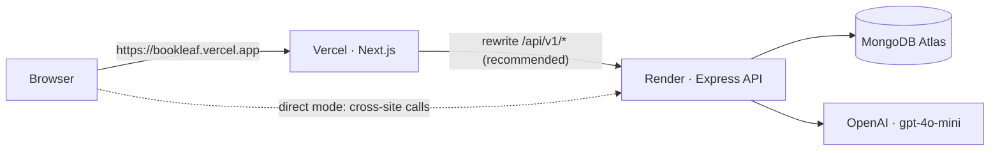

# Deployment guide

Target setup: **Vercel** (Next.js frontend), **Render** (Express API, `render.yaml`) and **MongoDB Atlas** (database). All three have free tiers that are enough for the demo.



## Choose a cookie mode first

The session is an httpOnly cookie (`bl_token`) issued by the API.

| | **A. Same-origin proxy (recommended)** | **B. Direct cross-site** |
|---|---|---|
| How | Vercel rewrites `/api/v1/*` to Render (`API_PROXY_TARGET`); the browser only talks to the Vercel domain | The browser calls `https://…onrender.com` directly |
| Cookie | First-party. Works in every browser | Third-party: `SameSite=None; Secure`. **Blocked by Safari by default, and by some privacy settings** |
| CORS | The browser makes same-origin calls; the API still checks `CLIENT_URL` | `CLIENT_URL` must exactly match the Vercel origin, with `credentials: true` |
| Client env | `NEXT_PUBLIC_API_URL=/api/v1`, `API_PROXY_TARGET=https://<api>.onrender.com` | `NEXT_PUBLIC_API_URL=https://<api>.onrender.com/api/v1` |
| API env | `TRUST_PROXY_HOPS=2` | `TRUST_PROXY_HOPS=1` |

Both modes work with the code as it is. In production the API always issues `SameSite=None; Secure; HttpOnly` cookies, which suits both: a first-party cookie isn't affected by `SameSite=None`. Mode A was verified locally through `next start` (login, cookie, `/auth/me` and SSE streaming all through the proxy). After deploying, confirm SSE stays connected through Vercel's edge (step 5).

## 1. MongoDB Atlas

1. Create a free **M0** cluster, and a database user with a strong password.
2. **Network Access → Add IP address → `0.0.0.0/0`**. Render's free instances don't have fixed outbound IPs. Access is still protected by the user/password and TLS. On a paid Render plan, use its static outbound IPs instead.
3. Copy the connection string and add the database name:
   `mongodb+srv://<user>:<password>@<cluster>.mongodb.net/bookleaf?retryWrites=true&w=majority`

## 2. Render (API)

1. Push the repo to GitHub.
2. Render dashboard → **New → Blueprint** → select the repo. Render reads `render.yaml`, which sets:
   - service `bookleaf-api`, `rootDir: server`
   - `npm ci --omit=dev` / `npm start`
   - health check `/api/v1/health`
   - Node 22
3. Fill in the prompted secrets:

| Variable | Value |
|---|---|
| `MONGODB_URI` | the Atlas string from step 1 |
| `OPENAI_API_KEY` | your key. Optional: without it, tickets get rule-based triage and drafts fall back to templates |
| `CLIENT_URL` | your Vercel origin, e.g. `https://bookleaf.vercel.app` (no trailing slash; comma-separate several, e.g. preview URLs) |

   Set automatically by the blueprint: `NODE_ENV=production`, `JWT_SECRET` (generated), `JWT_EXPIRES_IN=7d`, `OPENAI_MODEL=gpt-4o-mini`, `TRUST_PROXY_HOPS=2` (change it to `1` for mode B), `AI_CLASSIFY_ON_CREATE=true`.

   Optional tuning, with defaults: `AI_TIMEOUT_MS=15000`, `AI_MAX_RETRIES=2`, `AI_BREAKER_THRESHOLD=3`, `AI_BREAKER_COOLDOWN_MS=60000`, `AI_PRICE_INPUT_PER_MTOK=0.15`, `AI_PRICE_OUTPUT_PER_MTOK=0.6`, `SSE_HEARTBEAT_MS=25000`, `SSE_MAX_STREAMS_PER_USER=5`, `RATE_LIMIT_WINDOW_MS=900000`, `RATE_LIMIT_MAX=300`.
4. Deploy, then open `https://<api>.onrender.com/api/v1/health`. Expect `"database":"up"` and `"ai":"configured"`. API docs are at `https://<api>.onrender.com/api/docs`.

> **Free-tier note:** Render's free instances sleep after ~15 minutes idle, and the first request after that takes ~30–60 s. Open `/api/v1/health` a minute before a demo, or use the Starter plan. The app is single-instance by design; see "Limitations" in the README for scaling out.

## 3. Seed the production database

The seed is idempotent. It upserts the 10 authors, 18 books, the admin and 7 demo tickets, and resets the demo passwords and ticket ages. It's safe to re-run before a demo.

**Option 1, from your machine** (works on any Render plan):

```bash
cd server
MONGODB_URI="<atlas uri>" JWT_SECRET="any-32-plus-character-placeholder-value" npm run seed
```

(On Windows PowerShell: `$env:MONGODB_URI="<atlas uri>"; $env:JWT_SECRET="any-32-plus-character-placeholder-value"; npm run seed`.) The seed doesn't use the JWT secret; the config check just requires one.

**Option 2, Render Shell** (paid plans): service → **Shell** → `npm run seed`.

The seed prints the credential table. Login: `admin@bookleaf.com` / `Admin@123`; every author / `Author@123`.

## 4. Vercel (frontend)

1. Vercel → **Add New → Project** → import the repo.
2. **Root Directory: `client`**. The framework preset is detected as Next.js, and the build/output defaults are fine.
3. Environment variables (Production, and Preview if you want previews to work):

| Variable | Mode A (recommended) | Mode B |
|---|---|---|
| `NEXT_PUBLIC_API_URL` | `/api/v1` | `https://<api>.onrender.com/api/v1` |
| `API_PROXY_TARGET` | `https://<api>.onrender.com` | (unset) |

   Both are read at **build** time, so redeploy after changing them.
4. Deploy. Then make sure Render's `CLIENT_URL` exactly matches the Vercel production origin, and redeploy the API if you change it.

## 5. Verify the deployment

- [ ] `https://<api>.onrender.com/api/v1/health` → `status: ok`, `database: up`, `ai: configured`
- [ ] `https://<api>.onrender.com/api/docs` loads Swagger UI
- [ ] On the Vercel URL, signing in as `ananya.reddy@email.com` lands on the author dashboard and shows books and royalty figures
- [ ] DevTools → Application → Cookies: `bl_token` is set (on the Vercel domain in mode A) with `HttpOnly`, `Secure`
- [ ] The sidebar shows **Live**. In DevTools → Network, the `stream` request has type `eventsource` and stays open, with `: ping` every 25 s
- [ ] Raise a ticket as the author. In a private window, as `admin@bookleaf.com`, it appears in the queue live with a toast and gets classified
- [ ] Open the ticket as admin: the AI draft loads. Send it, and the author's open ticket page shows the reply without a refresh
- [ ] Safari (mode A): sign in works and stays signed in after a reload

## Troubleshooting

| Symptom | Cause / fix |
|---|---|
| `403 FORBIDDEN "Origin … is not allowed"` | `CLIENT_URL` on Render doesn't exactly match the browser origin (scheme, host, no trailing slash). |
| Login succeeds, but the next request is `401` | Mode B in a browser blocking third-party cookies → switch to mode A. Or the API isn't on HTTPS (`Secure` cookies need HTTPS). |
| "Reconnecting" indicator flickers every few minutes | A proxy closed the long-lived stream. The client reconnects automatically and the server replays missed events (`Last-Event-ID`), so nothing is lost. If it's constant, use mode B for the stream or check the proxy's timeout. |
| First request takes ~1 minute | Render free instance waking up. |
| `MongoServerSelectionError` in Render logs | Atlas Network Access doesn't allow Render's IPs, or the URI/password is wrong. |
| AI draft returns 503 with a template | `OPENAI_API_KEY` missing or invalid, or OpenAI unreachable (the circuit breaker opens after 3 failures for 60 s). `GET /api/v1/admin/ai/usage` shows `client.circuit`. |
| Everyone shares one login rate limit | `TRUST_PROXY_HOPS` is too low for your proxy chain (mode A needs `2`). |
