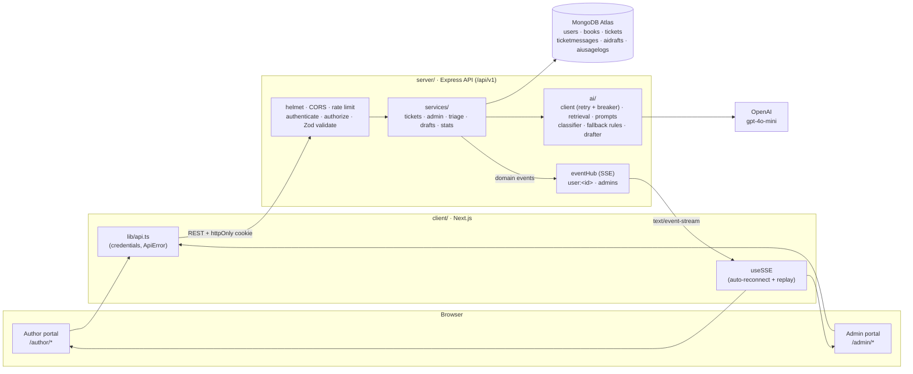

# BookLeaf Author Support & Communication Portal

A support portal for BookLeaf Publishing with two sides:
- **Authors** see their books, royalties and production status, raise tickets, and get replies live.
- **The operations team** works an **AI-triaged queue** and answers from **AI-drafted replies** grounded in BookLeaf's knowledge base and each author's real book data.

| | |
|---|---|
| **Live demo** | Frontend: `https://<your-app>.vercel.app` · API: `https://<your-api>.onrender.com` *(fill in after deploying; see [DEPLOYMENT.md](DEPLOYMENT.md))* |
| **API docs** | Swagger UI at **`/api/docs`** · raw spec at `/api/docs/openapi.json` · Postman collection in [`docs/postman/`](docs/postman/BookLeaf.postman_collection.json) |
| **More docs** | [ARCHITECTURE.md](ARCHITECTURE.md) · [server/docs/AI_DESIGN.md](server/docs/AI_DESIGN.md) · [DEPLOYMENT.md](DEPLOYMENT.md) · [WRITEUP.md](WRITEUP.md) |

---

## Test credentials

`npm run seed` creates these accounts from the provided dataset.

| Role | Name | Email | Password | Worth trying because… |
|---|---|---|---|---|
| **Admin** | BookLeaf Support | `admin@bookleaf.com` | `Admin@123` | Queue, AI triage, AI drafts, stats |
| Author | Priya Sharma | `priya.sharma@email.com` | `Author@123` | 2 live books, ₹3,570 pending |
| Author | Rohit Kapoor | `rohit.kapoor@email.com` | `Author@123` | Bestselling books; ISBN-mismatch ticket |
| Author | Ananya Reddy | `ananya.reddy@email.com` | `Author@123` | **Royalty never paid** (₹2,546): Critical ticket |
| Author | Vikram Joshi | `vikram.joshi@email.com` | `Author@123` | Print-defect ticket with photos attached |
| Author | Meera Nair | `meera.nair@email.com` | `Author@123` | Fully-paid + pending books; resolved ticket |
| Author | Arjun Malhotra | `arjun.malhotra@email.com` | `Author@123` | New author, never paid (₹2,464) |
| Author | Sneha Kulkarni | `sneha.kulkarni@email.com` | `Author@123` | **Book in production** (Cover Design) |
| Author | Farhan Sheikh | `farhan.sheikh@email.com` | `Author@123` | Book "unavailable on Amazon" ticket |
| Author | Kavita Deshmukh | `kavita.deshmukh@email.com` | `Author@123` | **Book in production** (Typesetting); **₹850 below the ₹1,000 minimum** |
| Author | Diya Chatterjee | `diya.chatterjee@email.com` | `Author@123` | Closed general question (author bio) |

The login page has a **Demo credentials** panel: click an account to fill in the form.

---

## Tech stack, and why

| Layer | Choice | Why |
|---|---|---|
| Frontend | **Next.js 16 (App Router) + Tailwind v4**, `lucide-react`, `sonner`, `recharts` | File-based routing for the two portals; Tailwind for a consistent, accessible design system; small focused libraries instead of a heavy component kit. |
| Backend | **Node.js 22 + Express 5** (ES modules) | A separate API keeps the OpenAI key, rate limits and long-lived SSE connections out of the frontend runtime. Express 5 forwards async errors natively, so there are no try/catch wrappers. |
| Database | **MongoDB + Mongoose 9** | Tickets with embedded attachments and a separate message thread map naturally to documents. Indexes are designed around the queue's sort order. |
| AI | **OpenAI `gpt-4o-mini`** | Narrow, grounded tasks (6-way classification; rewriting supplied facts in a set tone) don't need a frontier model. About **$0.0005 per ticket** measured, ~1.5 s to classify, reliable JSON mode. The model is a config value, and one client wrapper makes it swappable. |
| Real-time | **Server-Sent Events** | Updates only flow server → browser. SSE runs over plain HTTP, gets through proxies, and reconnects automatically, which is simpler than WebSockets. |
| Validation / tests | **Zod**, **Jest + supertest + mongodb-memory-server** | One schema language for requests and AI output. Integration tests run against the real app and a throwaway MongoDB, with OpenAI mocked. |

---

## Architecture



**Server layers** (`server/src`):
- `routes` map URL → middleware → controller.
- `controllers` are thin HTTP adapters.
- `services` hold the business rules, ownership scoping and event emission.
- `models` are Mongoose schemas and indexes.
- `validators` are Zod schemas.
- `ai` is the only code that talks to the LLM.

Dependencies point one way: routes → controllers → services → models / ai. Full details: [ARCHITECTURE.md](ARCHITECTURE.md).

**Frontend** (`client`):
- Each route is a thin server `page.tsx` (metadata + Suspense) around a client view.
- Data is fetched in the browser, because the session cookie belongs to the API.
- A single SSE stream per tab feeds toasts and live updates.

---

## Local setup

**Prerequisites:** Node.js ≥ 20.6 (22 recommended), and a MongoDB connection string (local `mongodb://127.0.0.1:27017/bookleaf` or an Atlas URI). An OpenAI API key is optional.

```bash
# 1. Install
git clone <repo-url> bookleaf && cd bookleaf
npm install --prefix server
npm install --prefix client

# 2. Configure the API
cp server/.env.example server/.env
#   MONGODB_URI=...                      (required)
#   JWT_SECRET=<32+ random chars>        node -e "console.log(require('crypto').randomBytes(48).toString('hex'))"
#   OPENAI_API_KEY=sk-...                (optional; without it: rule-based triage + reply templates)

# 3. Configure the client (defaults to http://localhost:5000/api/v1)
cp client/.env.example client/.env.local

# 4. Seed the database (idempotent; prints the credential table)
npm run seed --prefix server

# 5. Run (two terminals)
npm run dev --prefix server     # API on http://localhost:5000  (docs: /api/docs)
npm run dev --prefix client     # App on http://localhost:3000
```

Open <http://localhost:3000> and pick a demo account. Run only **one** API dev server per database. Several watchers would each run the startup recovery job, although the classification lease prevents duplicate AI calls.

### Tests

```bash
npm test --prefix server              # 215 unit/integration tests: Jest + supertest + in-memory MongoDB, OpenAI mocked
npm run test:e2e --prefix server      # 45 end-to-end API + SSE tests on the seeded dataset
npm run test:e2e --prefix client      # 33 Playwright tests (headless Chromium), isolated stack on :3100/:5100
npm run verify:seed --prefix server   # counts and duplicates in your database after `npm run seed`
npm run lint --prefix client          # ESLint (Next + React Compiler rules)
npm run build --prefix client         # type-check + production build
```

Two scripts use the **real** OpenAI key from `server/.env`, on an in-memory database (well under $0.01 per run):

```bash
npm run eval:ai --prefix server         # 17 labelled tickets + 10 drafts, scored; writes qa/
npm run qa:degradation --prefix server  # invalid key, timeout, 429: the server must keep working
```

Results, screenshots and the bug log are in [QA_REPORT.md](QA_REPORT.md).

---

## API overview

Base path `/api/v1`. **Full reference: `/api/docs`** (OpenAPI 3). A test checks the spec against the server's route table in both directions, so it can't drift.

| Area | Endpoints | Access |
|---|---|---|
| Health | `GET /health` | public |
| Auth | `POST /auth/login` · `POST /auth/logout` · `GET /auth/me` | login rate-limited |
| Author: books | `GET /books` · `GET /books/:bookId` | author, own books only |
| Author: tickets | `GET /tickets` · `POST /tickets` · `GET /tickets/:ticketId` · `POST /tickets/:ticketId/messages` · `GET /tickets/stream` (SSE) | author, own tickets only |
| Admin: queue | `GET /admin/tickets` · `GET /admin/tickets/:ticketId` · `PATCH /admin/tickets/:ticketId` · `POST …/assign-to-me` · `POST …/notes` · `POST …/reply` · `GET /admin/tickets/stream` (SSE) | admin |
| Admin: AI | `POST /admin/tickets/:ticketId/draft[?regenerate=true]` · `POST /admin/tickets/:ticketId/classify` · `GET /admin/ai/usage` | admin |
| Admin: reporting | `GET /admin/stats` · `GET /users` | admin |

Conventions:
- **Auth:** an httpOnly `bl_token` cookie (browser), or `Authorization: Bearer <token>` (tools; the token is returned by login).
- **Status codes:** 401 when not signed in; 403 for the wrong role; **404 for another author's resources**, indistinguishable from missing ones; 400 for bad URL params; 422 for an invalid body; 409 for state conflicts; 429 when rate-limited; 503 when the AI is unavailable.
- **Errors** always look like `{ success: false, error: { code, message, details: [{ field, message }], requestId } }`.
- **References:** tickets and books accept a Mongo id or the human code (`BL-0005`, `BK013`).

---

## AI integration

Full design, measurements and failure matrix: **[server/docs/AI_DESIGN.md](server/docs/AI_DESIGN.md)**.

**1. Classification** (on every new ticket, in the background)
- One JSON-mode call at temperature 0. The system prompt holds the 6 categories and a **priority rubric** taken from the brief: 6+ months unpaid or a duplicate ISBN is Critical; print defects or unavailable listings are High; a bio update is Low.
- The input is only subject + description (≤1,500 chars) plus ~60 tokens of **account context**: tenure, the book's paid/pending royalty, months since last payout. So "waiting for my royalty" is Critical for Ananya (never paid in 28 months) but Medium for a new author.
- The prompt treats ticket text as data (a prompt-injection guard).
- Output is **Zod-validated**. Invalid output falls back to rules.
- The AI's values are stored separately from the final ones (`aiCategory`/`aiPriority`, plus override flags), so admin overrides measure AI accuracy.
- Live check: all 7 seeded tickets were classified exactly as hand-triaged.

**2. Draft replies** (when an admin opens a ticket)
- **Prompt strategy:** a static system prompt holds BookLeaf's tone guidelines and hard rules: never invent amounts, dates or policies; own BookLeaf's errors; give a 48-hour timeline when escalating; end with a next step; sign off "Team BookLeaf".
- **KB retrieval:** the knowledge base is structured data (`ai/knowledgeBase.js`). Each category maps to 1–2 sections, plus **one matching few-shot example** from the brief, never the whole KB.
- **Author facts are computed by code, not the model:**
  - the referenced book's real figures
  - "₹850 is below the ₹1,000 minimum, so it rolls over"
  - "Next scheduled payout deadline: 14 November 2026", from today's date and the quarterly + 45-day rule
  - "OVERDUE CHECK: no payout for 27 months…"
  - production stage for unpublished books, with an explicit "don't quote royalty"
- **Thread window:** only the last 3 messages. Internal notes may provide facts but never opinions.
- **Guard rails:** any ₹ amount not in the records produces a warning for the admin. The sign-off is enforced. Truncation is flagged.

**3. Error handling and fallback**
- One client wrapper with a **15 s timeout**, **2 retries** (exponential backoff + jitter, honours `Retry-After`; no retry on 4xx) and a **circuit breaker**: 3 failed calls pause AI for 60 s, then a half-open trial. `/health` reports `ai: degraded` while it's open.
- **Ticket creation never waits on the AI.** The ticket is saved and returned first, then classified in the background.
- If the AI fails, **weighted keyword rules** set category and priority. They are labelled "Rule-based fallback" and are right on all 7 seed tickets.
- Draft failure → `503` with a **policy-safe template** and the last good draft. The UI shows a non-blocking banner, and manual replies always work.
- An **atomic lease** stops two processes from classifying (and paying for) the same ticket. Restarts recover pending tickets.

**4. Cost management** (gpt-4o-mini list price: $0.15 / $0.60 per 1M input/output tokens)

| Call | Tokens (live, OpenAI-reported) | Cost |
|---|---|---|
| Classification | ~565 in + ~38 out | ≈ $0.00011 |
| Draft (retrieval) | ~1,030 in + ~150–195 out | ≈ $0.00025 |
| **Per ticket** (1 classification + ~1.5 drafts) | | **≈ $0.0005 → ~$0.50 per 1,000 tickets** |

- Retrieval sends **~53% fewer draft input tokens** than the full KB would.
- Drafts are **cached per ticket**. The cache key covers the prompt and KB version, ticket text, category, book data, newest message and date, so reopening a ticket is free.
- Inputs are truncated and `max_completion_tokens` is capped.
- Ticket creation is rate-limited per author, and AI endpoints have their own limiter.
- A kill switch (`AI_CLASSIFY_ON_CREATE`).
- Every call is logged with tokens, cost, latency and outcome. **`GET /admin/ai/usage`** reports cost per ticket, failure rate and cache-hit rate, and the dashboard shows the 30-day spend.

**5. Model choice:** `gpt-4o-mini`. Both tasks are grounded and constrained, so a small model plus good context beats a large model with none, at a tenth of a cent per ticket. It's configurable via `OPENAI_MODEL`.

---

## Real-time updates (Server-Sent Events)

| Stream | Who | Events |
|---|---|---|
| `GET /api/v1/tickets/stream` | author (own tickets only) | `admin_reply`, `status_changed` |
| `GET /api/v1/admin/tickets/stream` | admin | `new_ticket`, `ticket_classified`, `author_reply`, `ticket_updated` |

- Streams authenticate with the httpOnly cookie (`EventSource` with `withCredentials`).
- Heartbeats every 25 s; at most 5 streams per user; cleanup on disconnect and shutdown.
- Every event has an id. Reconnecting with `Last-Event-ID` replays the last 10 minutes; if the gap can't be filled, `ready.resync` tells the client to refetch.
- Author payloads are built from a field whitelist, and publishing an internal note to an author throws.

**Limitation:** the hub (`server/src/services/eventHub.js`) is in-memory, so it works for **one API instance**. Behind a load balancer with several instances, an event published on one wouldn't reach clients on another. The fix needs no change to the services that emit events:
1. **Redis pub/sub** behind `eventHub.publish()`, with each instance delivering to its local clients.
2. **Redis Streams** for the replay buffer.

---

## Security notes

- **Secrets only in env.** `OPENAI_API_KEY`, `JWT_SECRET` and `MONGODB_URI` live in `server/.env` (gitignored; `.env.example` templates committed). The client only has `NEXT_PUBLIC_API_URL`. Every AI call goes through the API. A repo-wide grep and a scan of the production client bundle found no key material.
- **Env validated at boot** (Zod). A bad config fails fast with a readable list of problems.
- **Sessions:**
  - The JWT is in an **httpOnly** cookie (`Secure; SameSite=None` in production, `Lax` locally), so it's out of reach of page scripts.
  - The HS256 algorithm is pinned.
  - The user is re-loaded on every request, so deletions and role changes apply immediately.
  - Logout clears the cookie.
- **RBAC:** `authenticate` on everything except health/login/logout, and `authorize('admin'|'author')` per area.
- **Ownership** is enforced *inside the query* (`scopeToOwner`), so lists can't leak, and another author's ticket is a 404, not a 403. Internal notes are filtered in the query (`findThread` fails closed without a role) and again by response presenters. SSE payloads for authors are built from a field whitelist.
- **Input:**
  - Zod on params, query and body.
  - Unknown body fields are stripped (no mass assignment), or rejected on strict admin endpoints.
  - JSON-only body parser, so cross-site forms can't post (CSRF).
  - Request size cap of 100 kB.
  - Search input is regex-escaped.
- **Hardening:**
  - `helmet`.
  - CORS allow-list (`CLIENT_URL`).
  - Rate limits: global; login (10 failed / 15 min); ticket creation (20 / h per author); AI endpoints.
  - Same response and timing for unknown email vs wrong password.
  - Same-area-only `?next=` redirects (no open redirect).
  - `X-Request-Id` on every response for support.

---

## Edge cases handled

- **Books in production** (BK013, BK015): `null` price and royalty, never fake zeros ("—" in the UI with a screen-reader explanation). The UI shows a 9-stage production stepper ("Cover Design, step 3 of 9"), and the AI is told explicitly not to quote figures for them.
- **Zero-payout books** (Ananya, Arjun, Kavita, Diya's new title): a "first payout" note with the next quarterly deadline. Overdue balances are flagged to the AI so it apologises and escalates.
- **Below the ₹1,000 minimum** (Kavita's ₹850): a "rolls over to next quarter" note in the UI and in the AI facts.
- **Fully paid** and **no sales yet** books: their own notes.
- **General / account-level tickets:** no book required. The AI gets a one-line-per-book account overview instead.
- **Ticket lifecycle:**
  - An author reply to a Resolved ticket reopens it.
  - A Closed ticket rejects author replies (409) with guidance to open a new one.
  - An admin reply to a Closed ticket must reopen it explicitly.
- **AI outages:** tickets are still created; rule-based triage; draft template; non-blocking banner; circuit breaker; recovery after restarts; no duplicate classification across processes.
- **Admin overrides** are never overwritten by late AI results, and the AI's values are kept for accuracy stats.
- **Real-time:** reconnects replay missed events; the client refetches when the gap can't be filled; one stream per tab.
- **Empty, loading and error states** on every screen; network errors are shown as "offline".

---

## Known limitations and future improvements

- **Horizontal scaling:** the SSE hub, replay buffer, AI circuit breaker and background jobs are in-process, which is correct for one instance. Next: **Redis pub/sub** behind `eventHub.publish()` and **Redis Streams** for replay.
- **AI jobs** run in-process (`runInBackground` + the lease + startup recovery). Next: a durable queue such as **BullMQ** with retries, dead-lettering and scheduled retry of `failed` classifications.
- **Attachments** are metadata only, as the brief allows. Next: **direct-to-S3 uploads** with presigned URLs, virus scanning, and image previews for print-defect tickets.
- **Retrieval** is a category → section map, which suits a 7-section KB. As the KB grows: **embeddings-based retrieval** (vector search) with the same token budget.
- **No measured classification accuracy yet.** Next: an **evaluation set** (the brief's examples + overridden tickets) run in CI, tracking category/priority agreement, plus Structured Outputs for the classifier.
- **No audit log.** Overrides are flagged but who changed what, and when, isn't recorded per field. Next: an append-only **ticket event log** (also useful for SLA reporting).
- **Notifications** are in-app only. Next: **email notifications** for replies and status changes, with digests and an unsubscribe option.
- **Deployment:** Render's free tier sleeps when idle (first request ~30–60 s). Cross-site cookies need the same-origin proxy mode for Safari (see [DEPLOYMENT.md](DEPLOYMENT.md)).
- Also: password reset and invites; agent-to-agent assignment UI; saved queue views; SLA-breach alerts; i18n (Hindi); end-to-end browser tests (Playwright) in CI.
